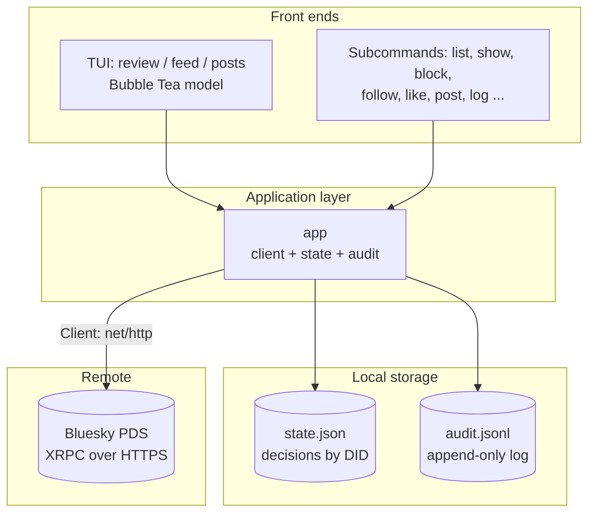
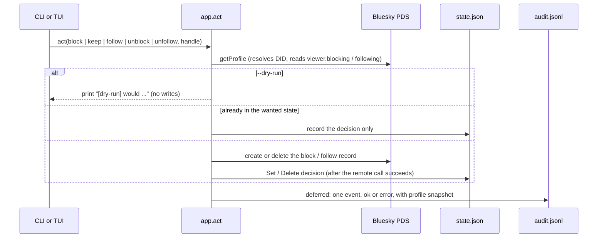
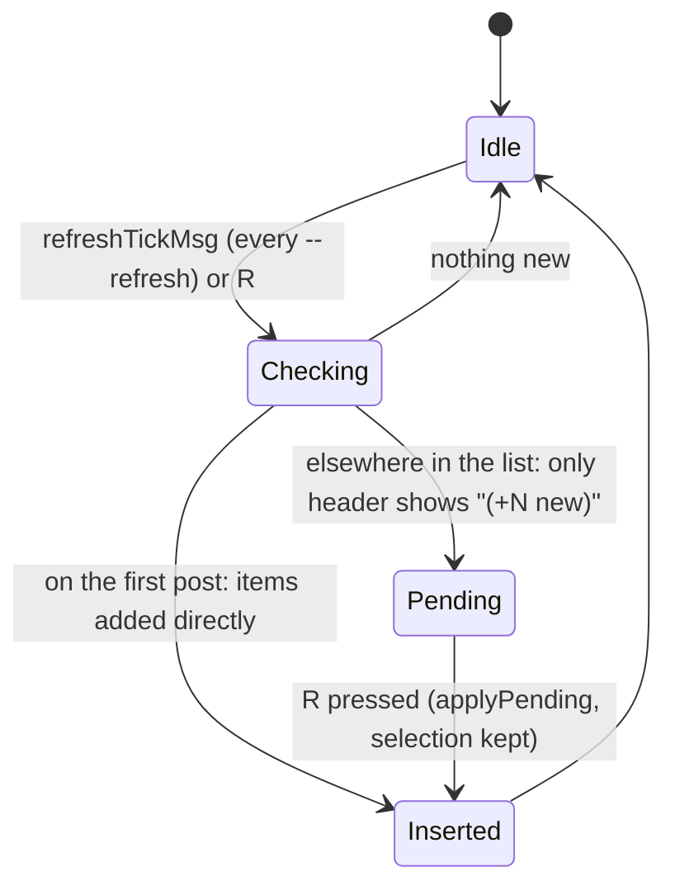

# Architecture: bskyban

This document describes the components and data flow of bskyban. For usage, keys and flags see `README.md`; for dependencies see `PKG.md`.

## High-Level Overview

bskyban is a single Go binary (`package main`, no sub-packages). It is a client for the Bluesky AT Protocol that offers two front ends over the same code: an interactive terminal UI (Bubble Tea) and scriptable subcommands. It talks only to the user's PDS over HTTPS and keeps two small local files.

Everything is in the repository root, one file per concern:

| File | Responsibility |
|------|----------------|
| `main.go` | Dispatch (`realMain`): picks the subcommand, parses TUI flags before login, loads state, logs in, builds `app`, starts the right front end |
| `api.go` | `Client`: XRPC calls, response types (`Profile`, `Post`, `FeedItem`, `Repost`), feed/embed parsing, record create/delete |
| `cli.go` | `app` and every non-TUI subcommand, `act` (the block/keep/follow/unblock/unfollow logic), usage text, plain-text formatting |
| `ui.go` | The single Bubble Tea `model`: messages, key handling, layout, rendering for all three TUIs |
| `state.go` | `State`: decisions per DID in a JSON file |
| `audit.go` | `Audit`: append-only JSON Lines log, the `log` subcommand, `Snapshot` of a profile |
| `links.go` | Sanitizing remote text, URL detection, OSC 8 hyperlinks, wrapping text without breaking links |
| `picker.go` | The `o` link picker for the selected post |
| `images.go` | `openURL`/`browserCommand` (OS-aware browser launch) and the `i` key |
| `theme.go` | The colour themes and how they are applied |

## Components

### 1. Entry point and dispatch (`main.go`)

`realMain` takes the first argument as the subcommand (plain `bskyban` is `feed`). Order matters:

1. `help`, `log` and `themes` run immediately and **need no login**.
2. For `review`, `feed` and `posts` the flags (`--theme`, `--since`, `--pages`, `--refresh`, ...) are parsed *before* credentials are read, so a usage error exits with code 2 without needing the network or a password.
3. `BSKY_HANDLE` / `BSKY_APP_PASSWORD` are read, state is loaded, and `Client.Login` creates a session.
4. The chosen mode runs: a TUI via `runTUI`, or `app.run` for everything else.

### 2. Bluesky client (`api.go`)

A hand-written client with no SDK. `Client.do` builds `<pds>/xrpc/<nsid>`, sends JSON, attaches `Authorization: Bearer <accessJwt>`, and turns non-200 responses into `nsid: message (error)` errors. It has a 30s HTTP timeout. `Login` uses `com.atproto.server.createSession` and keeps only the access token, DID and handle: the app password is never stored and there is no token refresh, so a session lasts as long as the access token.

- **Reads**: `app.bsky.graph.getFollowers`, `app.bsky.actor.getProfile(s)`, `app.bsky.feed.getAuthorFeed` (recent posts), `getTimeline`, `getPosts`.
- **Writes** are record operations in the user's repo through `com.atproto.repo.createRecord` and `deleteRecord`: `Block`, `Follow`, `Like` and `Post` create records (`app.bsky.graph.block`, `graph.follow`, `feed.like`, `feed.post`) and return the record URI; `Unblock`, `Unfollow`, `Unlike` and `DeletePost` delete a record by URI. Which URI to delete comes from the profile's `viewer` fields (`blocking`, `following`) or from state.
- **Feed parsing**: `feedEntry` models a timeline item. `isRepost` detects `reasonRepost`; `item()` turns an entry into a `FeedItem` (the post, its author, who reposted it, and counts); `viewContext` and `describeEmbed` extract quote posts, link cards, images and video markers; `expandLinks` replaces truncated link text with the full URL from the post's facets.
- **Sanitizing**: `Profile.UnmarshalJSON` and the error path run remote strings through `terminalText` so display names, bios and error messages cannot inject terminal escapes.

### 3. Local storage (`state.go`, `audit.go`)

- **State** is a map from DID to `Entry{Handle, Decision, At}`, where `Decision` is `blocked`, `kept`, `followed` or `skipped`. It decides which followers and repost authors count as "new". `Save` writes a temp file and renames it (mode `0600`, directory `0700`), so a crash never leaves a half-written file.
- **Audit** is append-only JSON Lines, guarded by a mutex and opened `O_APPEND`. Each `AuditEvent` records the time, action, DID, handle, source (`cli` or `tui:*`), previous decision, the record URI created or deleted, whether it was a dry run, the error if any, and a `Snapshot` of the profile at the time. It holds no secrets and is never rewritten. `bskyban log` reads it without logging in.

Both paths default to `~/.local/state/bskyban/` (or `$XDG_STATE_HOME`) and can be overridden with `BSKYBAN_STATE` / `BSKYBAN_AUDIT`.

### 4. The `app` and decisions (`cli.go`)

`app` ties together `*Client`, `*State`, `*Audit` and the I/O streams. Both front ends call the same methods, so a block from the TUI and a block from `bskyban block` behave identically.

`app.act` is the single place that changes an account relationship:

Because the audit write is deferred, every attempt is logged, including dry runs and failures. The remote change happens *before* the local state change, so a failed remote call leaves state untouched, and a failed local save after a successful remote call is surfaced (see Resilience).

`feedCandidates` builds the Reposts queue: it takes the reposts found in the timeline (`GetTimelineReposts`, `--pages` pages of 100 items), keeps the **original author** of each, drops anyone you follow, have blocked or already decided on (`isNew`), and collapses duplicates while remembering every `By` handle that reposted them (`repostCtx`).

### 5. The TUI (`ui.go`)

One `model` type serves all three TUIs. What differs is configuration, not code:

| Mode | Tabs | Loader | Timeline source |
|------|------|--------|-----------------|
| `review` | candidates (new followers) | `app.followers` | none |
| `feed` (default) | Following + candidates (repost authors) | `app.feedCandidates` | `GetTimeline` |
| `posts` | your own posts (Following tab only) | none | `GetOwnPosts` |

It follows the Elm pattern. `Init` fires the first loads; `Update` handles key presses and asynchronous result messages; `View` renders from the model alone. All I/O runs inside `tea.Cmd` functions that return a message:

| Message | Meaning |
|---------|---------|
| `loadedMsg`, `followingMsg` | candidate list / a timeline page arrived |
| `profileMsg`, `postsMsg` | a profile / an author's recent posts arrived (prefetched for the current and next item) |
| `actMsg` | a block/follow/keep/skip finished (carries the undo entry and any record URI) |
| `postedMsg`, `likedMsg`, `deletedMsg` | compose, like and delete results |
| `refreshTickMsg`, `newItemsMsg` | background check for new posts and its result |
| `animTickMsg` | redraw while a `--fancy` highlight fades |

Layout is two columns: the profile (age, join date, avatar, post/follower/following counts, posts per day, follower ratio, "follows you") on the left, the posts on the right. Wide lines are wrapped by `wrapText` (in `links.go`), which keeps URL pieces linked across wrapped lines.

#### Following tab: new-post refresh

A check is read-only and only requests the newest page(s). New posts are deliberately *not* inserted while you read, so the list never shifts under you.

#### Undo and decisions

Each decision pushes an `undoEntry` (the profile, the previous `Entry`, and the record URI it created). `u` pops the latest entry for the current tab: it deletes the block/follow record that decision created and, if the previous decision was also a remote one (block or follow), recreates it, then restores the previous state entry. Re-deciding an already-handled account lifts the earlier block/follow record first (`lifted`).

#### Resilience

- Actions run one at a time (`busy`); `q` during an action waits for it, its save and its audit entry.
- If the remote call succeeded but the state file could not be written, the model keeps the result in `pending` and shows `press r to retry saving`; further decisions and quitting wait until the save succeeds, so the remote and local records cannot silently diverge.
- Blocking an account you follow asks for a second `b`.
- A failed background check shows `⚠ refresh failed` in the header and clears on the next good check.

### 6. Rendering remote text safely (`links.go`)

Bluesky text is untrusted input in a terminal. `terminalText` strips ANSI sequences and control characters from every remote string *before* styling or hyperlinks are added (never on already-rendered output). `linkify`, `splitWord` and `osc8` then wrap URLs and `@handle` mentions in OSC 8 hyperlinks, ignoring styling escapes so links are never detected inside them. In terminals that support OSC 8 the links are clickable (in Ghostty on macOS, Cmd+click); `visibleWidth` ignores the escapes when measuring.

### 7. Opening links and images (`picker.go`, `images.go`)

- `o` builds `postLinks` for the selected post, in a fixed order: the post on bsky.app, its link card, URLs in the text, the quoted post, mentioned accounts, the author's profile; duplicates are dropped and the list is capped at nine. `1`-`9` opens one; `o` again opens the single outside link, or the post itself. Any other key closes the picker.
- `i` opens the post's images. Both use `openURL`, which runs `browserCommand`: `$BROWSER` if set (first colon-separated entry, `%s` marks the URL; on ChromeOS Linux this is `garcon-url-handler`), otherwise `open` on macOS, `xdg-open` elsewhere. The command is started and reaped in the background; it is a variable so tests replace it.

### 8. Themes (`theme.go`)

A `Theme` is a set of Lip Gloss colours plus the selected-row colour and the `--fancy` fade colours. `applyTheme` assigns the package-level styles used by `ui.go`. `resolveTheme` picks `--theme`, then `BSKYBAN_THEME`, then `auto`. Adaptive themes (`auto`, `catppuccin`) use Lip Gloss `AdaptiveColor`, which needs the terminal's background, so `runTUI` calls `lipgloss.HasDarkBackground()` **once, before the Bubble Tea program starts**. Querying lazily on the first draw lets Bubble Tea's input reader swallow the terminal's reply (or read it as keys), and a terminal that never answers would stall the first frame for termenv's 5s timeout. Fixed themes skip detection. `NO_COLOR` is honoured and the `▸` marker still shows the selection.

## Data Flow

1. **Start**: the binary parses flags, logs in with the app password, loads `state.json`.
2. **Load**: the TUI's `Init` loads the candidate list and, in feed mode, the first timeline page, and schedules the refresh tick.
3. **Browse**: moving the selection prefetches the current and next profile and the author's recent posts, so the next account is usually ready.
4. **Decide**: a key press becomes an `act` (remote record change, then local state, then audit entry), run in a `tea.Cmd`; the result returns as `actMsg` and the model advances to the next account.
5. **Post, reply, like, delete**: the same shape: a `tea.Cmd` calls the client, the result message updates the list, and an audit event with source `tui:following` is written.
6. **Refresh**: ticks check for new posts read-only; nothing is inserted until you are at the top or press `R`.

## Design Principles

- **Dependency-light**: the Bluesky API surface is about ten XRPC methods (`createSession`, `getProfile(s)`, `getFollowers`, `getTimeline`, `getAuthorFeed`, `getPosts`, `createRecord`, `deleteRecord`) over `net/http`, so there is no SDK and the only dependencies are the Charm UI libraries and `uniseg`.
- **One logic path for both front ends**: `app.act` and the client methods back the TUI and the subcommands alike, so behaviour and audit entries cannot drift apart.
- **Read-only until you press a key**: browsing, refreshing and prefetching never write; every write is an explicit action and has `--dry-run` in the CLI.
- **Everything is reversible and recorded**: decisions can be undone, and every attempt, including failures and dry runs, is in the audit log with the profile as it was.
- **Remote data is untrusted**: text is sanitized at the edge (JSON decoding and error messages) and again before display, and styling/hyperlinks are only added to already-clean text.
- **Local state cannot be half-written**: atomic rename for state, append-only audit, and a retry path when a save fails after a remote success.
- **Least privilege**: use an app password without direct-message access; it is read from the environment and never written to disk.

## Testing

`go test ./...` covers the logic with in-process fakes. `feed_test.go` and `ui_test.go` use `httptest` servers in place of the PDS; the rest test pure functions (link wrapping, theme resolution, the picker, state and audit files, layout, the refresh and compose flows) and drive the model by sending it messages. `smoke.sh` runs the real binary against a real account without changing it: only read-only requests and `--dry-run`, never the TUI, with a temporary state directory.
