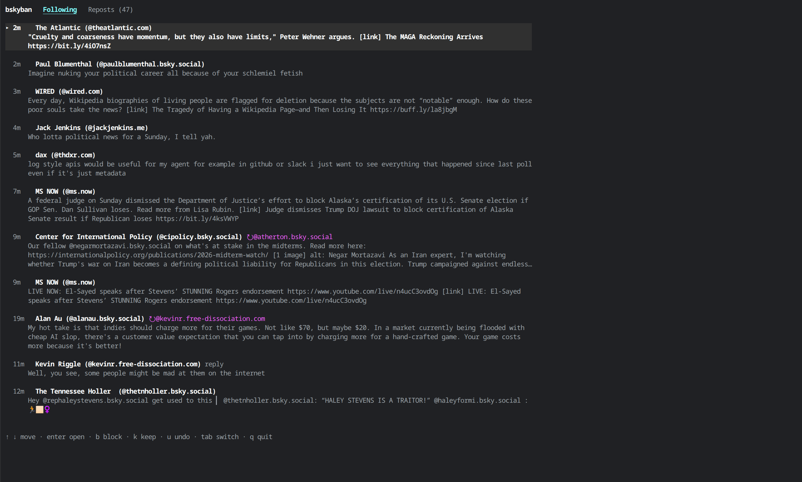
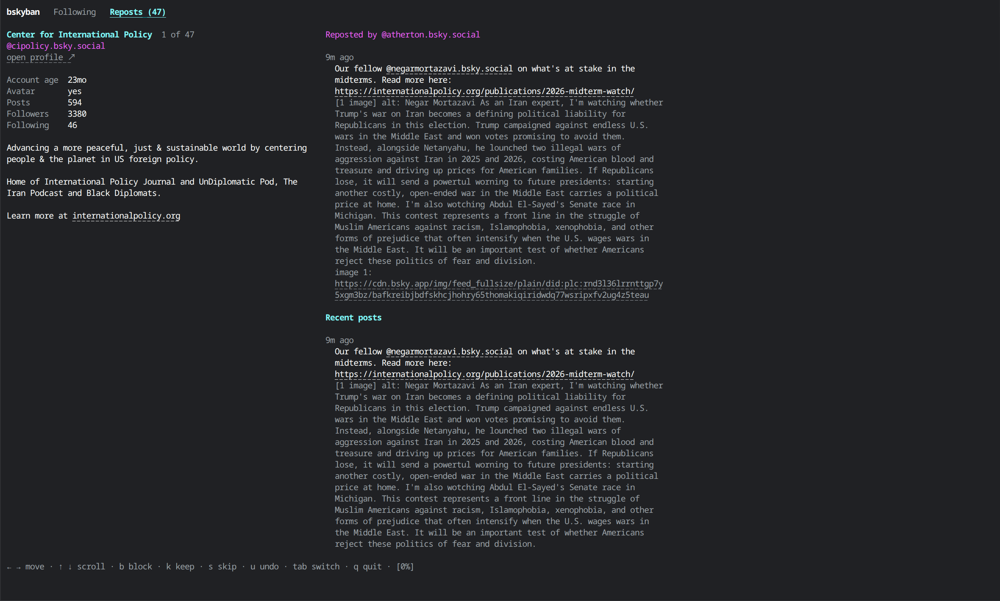

# bskyban

Review new Bluesky followers one at a time and block the spam. Works as an
interactive terminal UI ([Bubble Tea](https://github.com/charmbracelet/bubbletea))
or as scriptable CLI commands, from one binary.

By default it only shows **new followers you don't follow back** and haven't
already decided on. For each one you see the profile (age, avatar, post and
follow counts, bio) next to their recent posts, then choose to block or keep.

## Screenshots

**Following** – your home timeline, a few lines per post. Reposts are tagged with who
reposted them; `Enter` opens a post in full.



**Reposts** – the original author of a reposted post, with their profile on the left and
the reposted post and their recent posts on the right. Block, keep or skip with one key.



## Install

Requires Go 1.26+ (see `go.mod`).

```sh
git clone https://github.com/mdfranz/bskyban
cd bskyban
make build        # produces ./bskyban
# or: go install github.com/mdfranz/bskyban@latest
```

## Setup

Create an **app password** in Bluesky: Settings → Privacy and Security → App
Passwords (<https://bsky.app/settings/app-passwords>). Don't use your main
password, and don't enable direct-message access.

```sh
export BSKY_HANDLE=you.bsky.social
export BSKY_APP_PASSWORD=xxxx-xxxx-xxxx-xxxx
```

| Variable | Purpose |
|---|---|
| `BSKY_HANDLE` | your handle (required) |
| `BSKY_APP_PASSWORD` | app password (required; never written to disk) |
| `BSKY_PDS` | PDS URL, default `https://bsky.social` |
| `BSKYBAN_STATE` | decisions file, default `~/.local/state/bskyban/state.json` |
| `BSKYBAN_AUDIT` | audit log, default `~/.local/state/bskyban/audit.jsonl` |
| `XDG_STATE_HOME` | moves the default state directory |
| `BSKYBAN_FANCY` | `1` turns on `--fancy` for `feed` and `posts` |

## TUI

```sh
bskyban                  # same as: bskyban review
bskyban review --since 20   # only the newest 20 followers
bskyban review --backlog    # also revisit followers you skipped before
```

| Key | Action |
|---|---|
| `→` / `l`, `←` / `h` | next / previous follower (just moves; records nothing) |
| `Home` / `End` | first / last follower |
| `↑` / `↓`, `PgUp` / `PgDn` | scroll the posts panel |
| `b` | block (creates a block on your account immediately) |
| `f` | follow (creates a follow on your account immediately; undo with `u`) |
| `k` | keep (record as reviewed, no action) |
| `s` | skip (hide from the default view; return with `--backlog`) |
| `u` | undo the last decision (restores whatever was recorded before) |
| `q` | quit |

Following someone records them as `followed`, so they leave the new list. Changing your
mind later works like a block: pressing `k`, `s` or `b` on a followed account removes
the follow first, and `u` puts it back.

Moving back to a follower you already handled shows what you decided (`● blocked`,
`● kept`, `● skipped`). Pressing a letter again overrides it: `k` or `s` on a
blocked account lifts the block, and `u` puts the previous decision back.

Profile on the left, recent posts on the right (replies, reposts, images, links,
videos and quote posts are labelled). URLs are clickable in terminals that
support OSC 8 hyperlinks. Decisions are saved as you go, so quitting midway
loses nothing.

Quitting during an action waits for it to finish, save, and write its audit entry.
If saving fails, the review stays on the current account. Fix the storage problem
and press `r` to retry saving without repeating the remote block or unblock;
further decisions and quitting wait until the save succeeds.

## Feed mode

```sh
bskyban feed                 # TUI with two tabs: Following and Reposts
bskyban feed --pages 5       # scan more of the timeline for the Reposts tab (100 items/page, default 3)
bskyban feed --refresh 1m    # check for new posts every minute (default 30s, 0 = off, minimum 10s)
bskyban feed --fancy         # highlight newly inserted posts (or BSKYBAN_FANCY=1)
bskyban feed --list [--json] # print the Reposts candidates instead
```

**Following** is your home timeline (accounts you follow). The list shows one post
per two lines; open one to see it in full next to its author's profile, including
the parent of a reply, quoted posts, image links and recent posts by the author.

| Key | List | Post view |
|---|---|---|
| `↑` / `↓` | move | previous / next post |
| `PgUp` / `PgDn` | move a page | scroll the panel |
| `Enter` / `→` | open post | next post |
| `Esc` / `Backspace` | | back to list |
| `←` | | previous post |
| `b` | block the author | block the author |
| `f` | follow the author | follow the author |
| `k` / `u` | keep / undo | keep / undo |
| `r` | reply to the selected post | reply to this post |
| `L` | like (again to remove your like) | like / unlike |
| `n` | write a new post | write a new post |
| `d` | delete your own post (press twice) | delete your own post (press twice) |
| `Tab` | switch tab | switch tab |

`r` opens the same box as a reply to the selected post, showing what you are answering
(the reply is placed in the right thread, even when the post is itself a reply).
`n` opens a box for a new post (`Enter` publishes, `Esc` discards; 300 characters, with a
counter). A failed post keeps your text so you can retry. Once posted, it is pulled in at
the top of the list. `d` on one of your own posts asks for a second `d`, then deletes it.
Both are written to the audit log (`tui:following`).

Blocking someone you follow asks you to press `b` a second time. More of the
timeline loads as you near the end.

**New posts.** Every `--refresh` interval (30s by default) it quietly checks for new
posts. If you are on the first post of the list they are added straight away and the
newest becomes the selection. Otherwise they are *not* inserted while you read: the
header just shows `Following (+3 new)`, so the list never shifts under you. Press `R` to
insert them at the top (with `--fancy`, inserted posts get a coloured bar and a `new`
tag that fade out over about 2 seconds); the post you were on stays selected (from the very top of the list, the
newest post is selected instead). `R` also refreshes right away if nothing is waiting.
Newly reposted authors you haven't handled are added to the end of the Reposts queue
(its count grows) without moving the account you're reviewing. A failed check shows
`⚠ refresh failed` in the header and clears itself on the next good one. One check is
one timeline request (up to 4 if more than a page of new posts arrived).

**Reposts** reviews people you *don't* follow who reach you through someone you
do: for each repost in your timeline it takes the original author, skipping
anyone you follow, have blocked or already decided on, each once. It works like
the follower review above, with "Reposted by @…" and the reposted post at the
top of the right panel. `b` blocks the original author; the account you follow
who reposted them is unaffected.

## CLI

```sh
bskyban list [--since N] [--backlog] [--all] [--json]
bskyban show <handle|did>
bskyban block [--dry-run] <handle|did>...     # "-" reads identifiers from stdin
bskyban keep <handle|did>...
bskyban unblock [--dry-run] <handle|did>...
bskyban follow [--dry-run] <handle|did>...
bskyban post [--dry-run] <text>...            # "-" reads the text from stdin
bskyban posts [--list [-n 20] [--json]]       # browse your own posts (TUI), or print them
bskyban unfollow [--dry-run] <handle|did>...
bskyban delete-post [--dry-run] <post>...     # at:// URI, bsky.app link or record key
bskyban like [--dry-run] <post>...            # at:// URI or bsky.app link
bskyban unlike [--dry-run] <post>...
bskyban baseline
```

- `list` prints new followers; `--backlog` adds skipped ones, `--all` lists everyone with their status.
- `baseline` marks every current unreviewed follower as old, so only followers who arrive afterwards show up by default. Run it once if you don't want to work through your existing backlog.
- `post` publishes a text post (max 300 characters; URLs become links). It is logged in the audit log like other actions.
- `posts` opens the feed browser limited to your own posts (`n` writes one, `d` deletes the selected one). With `--list` (or `--json`) it prints your latest `-n` posts instead, each with the record key `delete-post` takes.
- `like` / `unlike` like or remove your like from any post, given as an `at://` URI or a `bsky.app` link. Liking a post you already liked does nothing.
- `delete-post` deletes your own posts, given as the `at://` URI, the `bsky.app` link or just the record key (the last part of the link). Anyone else's post is refused.
- Exit codes: `0` ok, `1` error, `2` usage.

Example: dry-run blocking everyone with no posts that follows over 1000 accounts:

```sh
bskyban list --json \
  | jq -r 'select(.posts == 0 and .following > 1000) | .did' \
  | bskyban block --dry-run -
```

## Audit log

Every block, unblock, post, keep, skip, undo and `baseline` is appended to
`~/.local/state/bskyban/audit.jsonl` (`$XDG_STATE_HOME/bskyban/` if set): one JSON
object per line, never rewritten, readable only by you (`0600`). Failed API calls and
`--dry-run` runs are logged too, flagged as such. It holds no password or token.
Feed-mode refresh checks that fail are logged too (action `refresh`, with the error): a
background failure once when it starts or its error changes, a failed manual `R` every time.
`bskyban log --action refresh` shows them.

Each entry has the time, action, account (DID and handle), where the action came
from (`cli`, `tui:review`, `tui:following`, `tui:reposts`), who reposted the account
into your timeline (`via`), the block record created or removed, the previous
decision, and a snapshot of the account at the time (account age, avatar, the first
200 characters of the bio, and post/follower/following counts when known).

```sh
bskyban log                          # latest 50 entries (no login needed)
bskyban log --since 7d --action block
bskyban log --who spam.bsky.social --json
```

## How "new" is decided

A follower is new if you don't follow them back and `state.json` has no entry
for them (that file is `state.json` in the state directory). `block` and `keep` record a decision; `s` and `baseline` record
"skipped". There is no follow timestamp in the Bluesky API, so this is
tracked locally.

## Development

```sh
make help     # list targets
make test
make smoke   # live, read-only CLI check against your account (see below)
make run ARGS="--since 10"
```

Talks to the AT Protocol XRPC API directly over `net/http` (no SDK):
`createSession`, `getFollowers`, `getProfile(s)`, `getAuthorFeed`, and
`createRecord`/`deleteRecord` for `app.bsky.graph.block`.

### Smoke test

`./smoke.sh` (or `make smoke`) runs the real CLI against your real account to check
that login, listing, `show`, the feed, local state and the audit log all work. It
**does not change your account**: `block` and `unblock` only ever run with
`--dry-run` (the script's wrapper aborts if anything else is attempted), the
interactive TUI is never started, and all local files go to a temp directory that is
removed afterwards. It needs `BSKY_HANDLE` and `BSKY_APP_PASSWORD` and takes a few
seconds.
